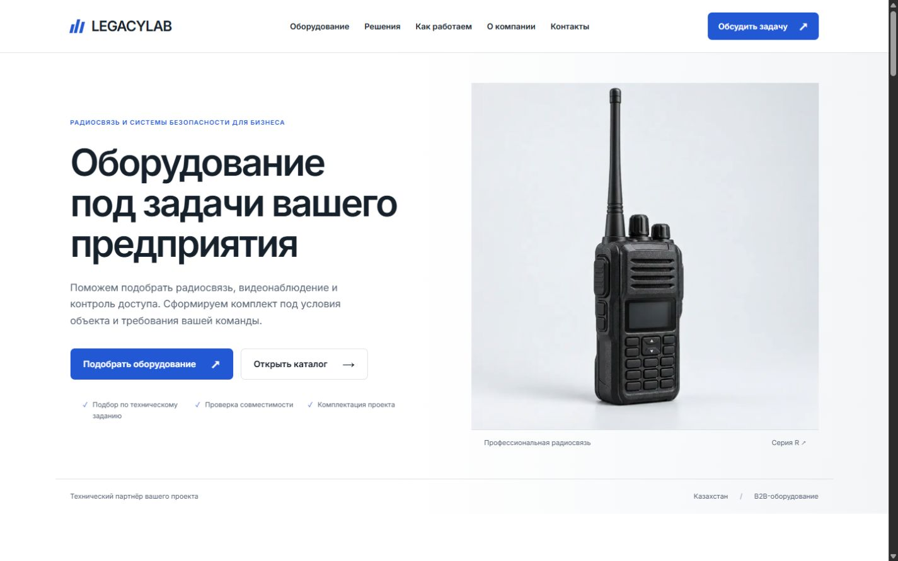

# LegacyLab — демонстрационный B2B-проект

Опубликованный сайт: https://legacylab-b2b-demo.tilda.ws/ . [Отчёт публикации](docs/08-tilda-publication.md).

Публикация на Tilda использует блоки T123 и требует Personal. Пробный период заканчивается 16.11.2026; на Free исполнение кода T123 отключается. Самостоятельная версия в `dist/` и офлайн-копия от Tilda не зависят. [Ограничения Free](https://tilda.cc/ru/answers/a/freeplan).

Локальная копия: начните с [готового офлайн-просмотра](offline/index.html): откройте файл в браузере, затем переходите в каталог и карточки. Интернет, Node и установка зависимостей для этого не нужны.

Альтернативный просмотр: запустите `START.cmd` (нужен Node.js), откройте http://127.0.0.1:4173. Страница http://127.0.0.1:4173/qa.html подготовлена для проверки трёх основных страниц на 1440, 1024, 768, 390 и 360 px. Остановить сервер — Ctrl+C в его окне.

## Комплект в порядке выдачи

1. [Концепция, карта сайта, визуальная система, структура и сценарии](docs/01-project.md).
2. [Полные тексты всех блоков](docs/02-copy-deck.md).
3. [Каталог из 12 моделей — CSV](catalog.csv) и [единые структурированные данные](catalog.json).
4. [План Tilda по секциям, выбранная конфигурация, готовые вставки и настройка получателя](docs/03-tilda.md).
5. [Материалы для публикации и критерии приёмки](docs/04-publication.md).
6. [Отчёт о выполненных проверках и ограничениях](docs/05-validation.md).
7. [Изображения, промпты и происхождение](docs/06-image-prompts.json).
8. [Проверка в браузере на пяти ширинах и снимки](docs/07-browser-qa.md).
9. [Фактическая публикация на Tilda](docs/08-tilda-publication.md).

`dist/` — обычный HTML/CSS/JS, без библиотек интерфейса и сборщика. Три основных типа страниц: главная, каталог, карточка R-450. Дополнительно подготовлены 11 карточек остальных моделей на том же шаблоне, действующая страница о данных демоверсии и 404. Все внутренние действия имеют назначение.

`tilda/embeds/` — опубликованные вставки T123 с изображениями на CDN Tilda; Inter выбран штатно в настройках сайта. Для их повторной генерации: `python tools/export.py --asset-map tilda/asset-map.json --native-font`. Без этих параметров скрипт создаёт самодостаточные вставки для просмотра. `tilda/sections/` — содержимое внутренних страниц для гибридной сборки с нативной шапкой и подвалом. Это исходный код, а не импорт в редактируемые блоки Tilda. Основную маркетинговую страницу рекомендуется собрать редактируемыми стандартными блоками и одним Zero Block по плану.

Изменения: редактируйте модельный список в `tools/build.py`, затем выполните `python tools/build.py` и `python tools/export.py`. `catalog.json`, CSV, HTML и текстовый комплект генерируются из одной структуры. Не редактируйте сгенерированный JSON отдельно. Шрифт Inter поставляется локально с OFL-лицензией. Растровые изображения созданы встроенным Imagegen, сохранены и оптимизированы в `dist/assets/`. SVG-схемы созданы кодом в `tools/build.py`.

Проверки: `npm ci --prefix tools`, затем `node tools/check.mjs` из этой папки. Пакеты нужны только для проверки DOM; на сайте зависимостей нет. Для повторной подготовки исходных изображений `tools/assets.py` использует оригиналы из текущего сеанса Imagegen; для обычной сборки этот шаг не нужен.

Статус: демонстрационный сайт опубликован на Tilda 02.11.2026. Проект `54225903`, 15 страниц. Пробный Personal включён до 16.11.2026 без банковской карты. Реальный получатель форм не подключён. При валидном вводе показывается «Проверка завершена. Запрос не отправлен». Данные никуда не передаются. Noindex включён во всех страницах; сервер отдаёт X-Robots-Tag, robots.txt закрывает обход.

Для облегчения локального шрифта добавлен `tools/optimize-font.py`: исходный Inter остаётся с OFL-лицензией, поднабор содержит латиницу, кириллицу и нужные символы (122 072 байта). При повторном создании поднабора установите `fonttools brotli` в `tools/.build-deps`; готовый шрифт уже включён, для обычной сборки установка не нужна.
